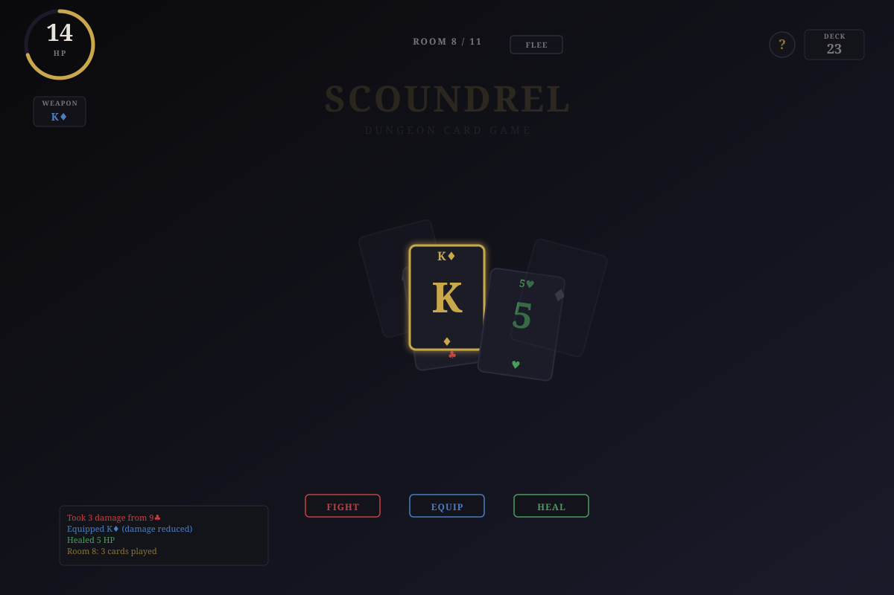
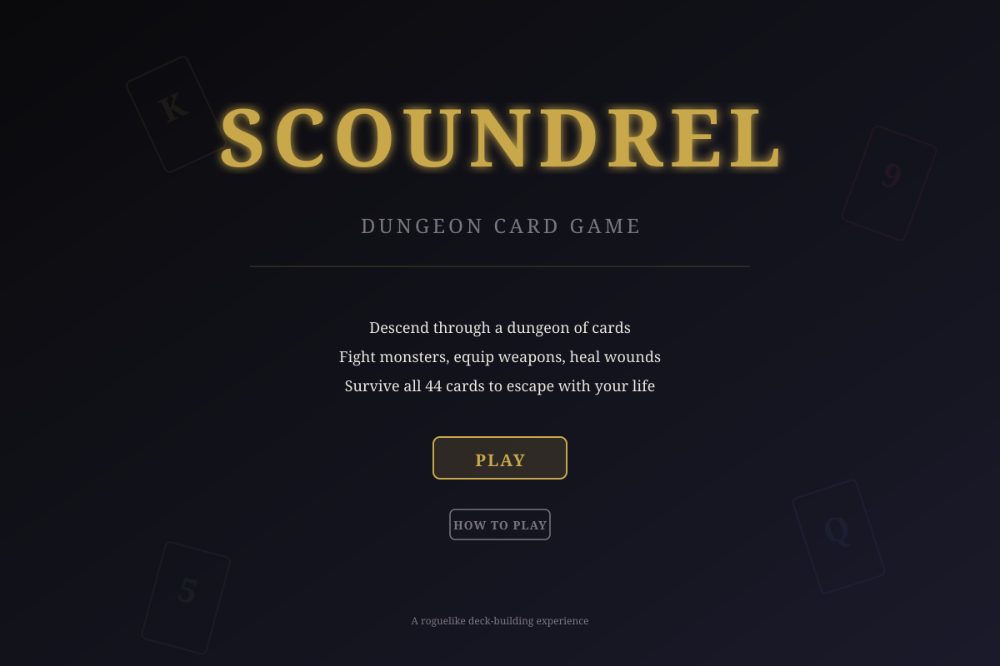
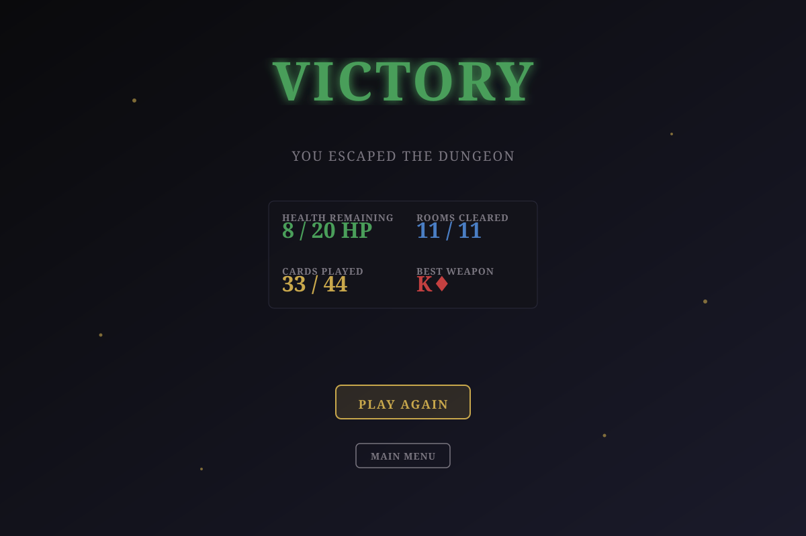
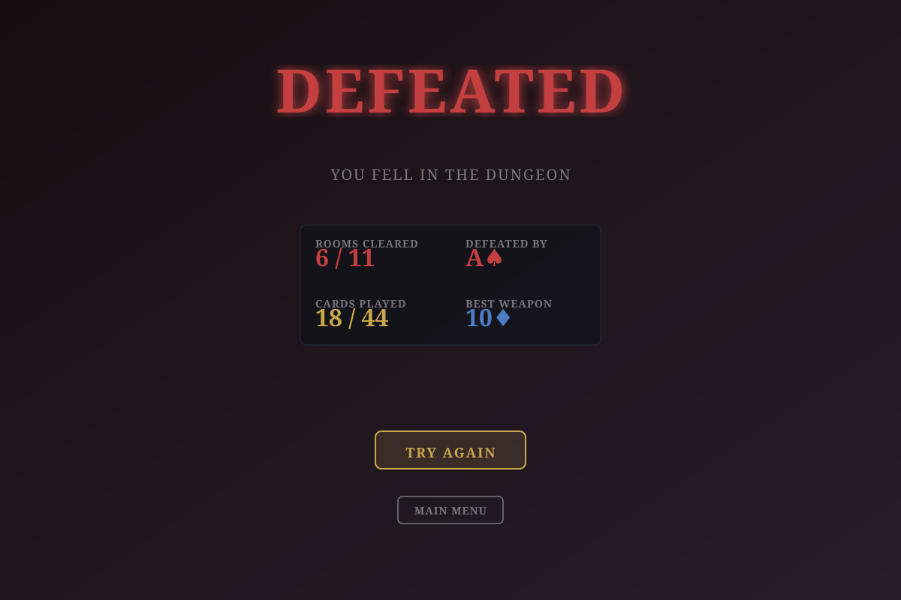
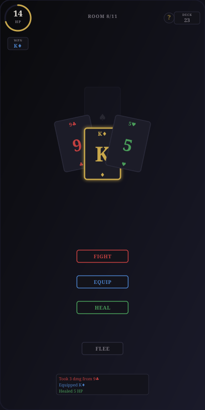

# Scoundrel: Dungeon Card Game

A roguelike deck-building game where you descend through a dungeon made of playing cards. Fight monsters, equip weapons, heal wounds, and survive all 44 cards to escape with your life.

## Preview

### Gameplay

The main game interface shows:
- **Health Wheel** (top-left): Your current HP with color-coded status
- **Weapon Info** (below health): Currently equipped weapon and its value
- **Deck Counter** (top-right): Cards remaining in the dungeon
- **Room Label** (center-top): Current room progress
- **Card Selection** (center): Four cards to choose from; select exactly 3 to advance
- **Action Buttons** (bottom): Fight, Equip, or Heal based on selected cards
- **Game Log** (bottom-left): Recent actions and events

### Title Screen

The starting screen with:
- Game title and tagline
- Play button to begin a new game
- How to Play button for rules and tips

### Victory Screen

Displayed when you successfully escape the dungeon:
- Final stats: Health remaining, rooms cleared, cards played, best weapon
- Play Again button for a new run
- Main Menu button

### Defeat Screen

Shown when your health reaches zero:
- Defeat message and final enemy
- Stats: Rooms cleared, cards played, best weapon used
- Try Again button for a new run
- Main Menu button

### Mobile View

Responsive design for phones (portrait orientation):
- Compact HUD elements
- Vertically stacked action buttons
- Touch-friendly card selection
- Optimized layout for 360px+ screens

## Game Mechanics

### Card Types

**Monsters** (♠ Spades, ♣ Clubs)
- Deal damage equal to their rank (2–14)
- Must be fought or fled from
- Damage is reduced by equipped weapons

**Weapons** (♦ Diamonds)
- Reduce monster damage
- Can only fight monsters with strictly lower values after first use
- Higher value = better protection

**Potions** (♥ Hearts)
- Heal HP (one per room maximum)
- Essential for survival in later rooms

### Game Flow

1. **Start** with 20 HP and a shuffled 44-card deck
2. **Each Room**: 4 cards are dealt
3. **Play Exactly 3 Cards**:
   - Fight monsters (take reduced damage if armed)
   - Equip weapons (replace current weapon)
   - Drink potions (heal HP)
   - Flee (shuffle room cards back into deck; can't flee twice in a row)
4. **Advance** to the next room
5. **Win** by surviving all 44 cards with HP > 0
6. **Lose** if health reaches 0

### Strategy Tips

- **Weapon Management**: Higher weapons are powerful but can't fight lower monsters after first use
- **Health Management**: Save potions for critical moments
- **Fleeing**: Use strategically to avoid bad rooms or reset weapon restrictions
- **Deck Awareness**: Track remaining cards to plan ahead

## Features

- **3D Graphics**: Cards rendered in Three.js with lighting and animations
- **Responsive Design**: Adapts from 360px phones to wide desktops
- **Dark Theme**: Elegant dark UI with gold accents
- **Smooth Animations**: GSAP-powered transitions and effects
- **Accessibility**: Semantic HTML, keyboard support, WCAG AA contrast
- **Help System**: Built-in tutorial explaining all mechanics

## Technical Stack

- **Rendering**: Three.js for 3D card visualization
- **Animation**: GSAP for smooth transitions
- **Styling**: CSS custom properties for theming
- **Fonts**: Cinzel (headings), Crimson Text (body)
- **Responsive**: Mobile-first design with media queries

## How to Play

1. Open `index.html` in a modern web browser
2. Click "Play" to start a new game
3. Select exactly 3 cards from the 4 dealt each room
4. Use action buttons to fight, equip, or heal
5. Survive all 11 rooms to escape the dungeon

## Browser Support

- Chrome/Edge 90+
- Firefox 88+
- Safari 14+
- Mobile browsers (iOS Safari, Chrome Mobile)

---

**Scoundrel** is a roguelike deck-building experience combining card game strategy with 3D visualization. Each run is unique—will you escape the dungeon?
